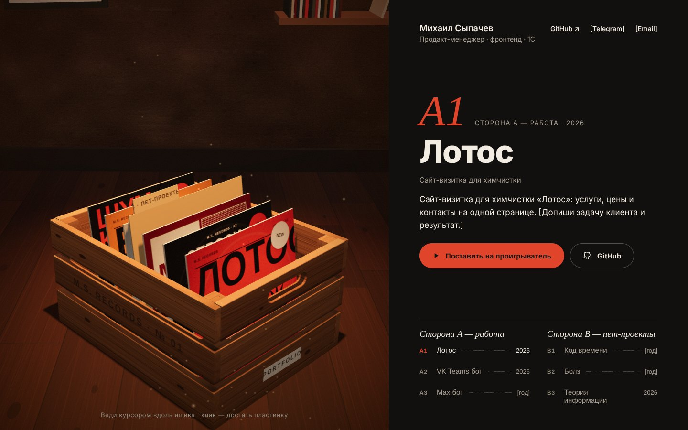
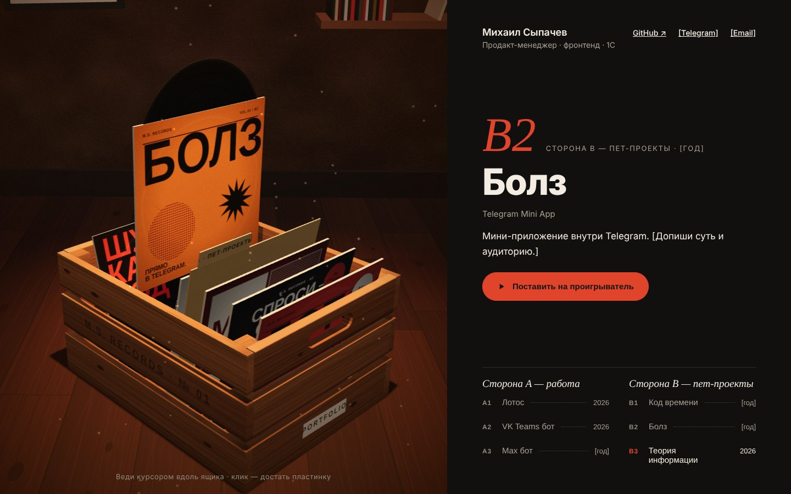
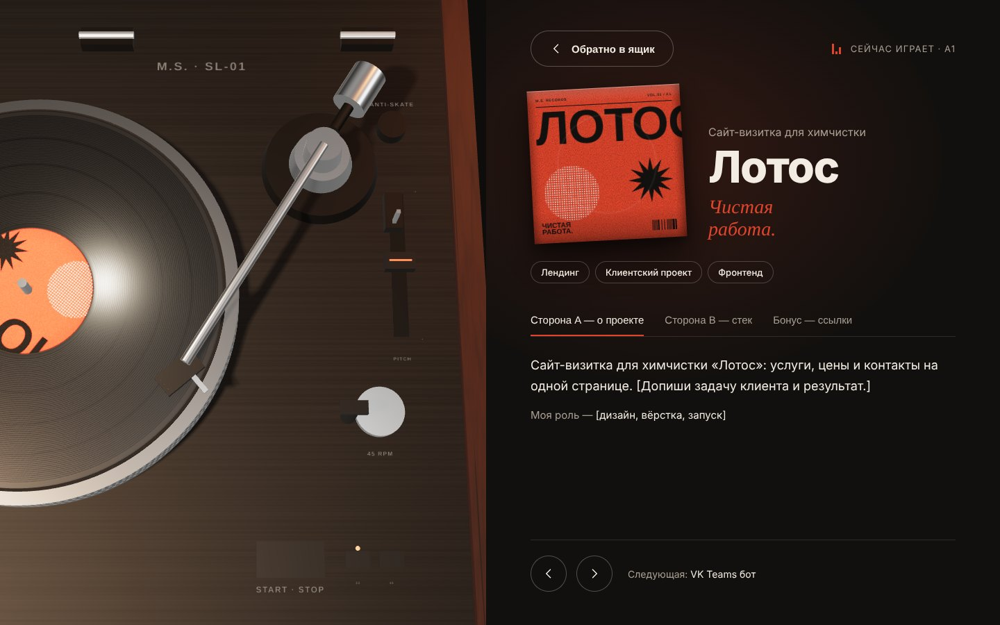

# Cutaway — портфолио в ящике с винилом

**Живой сайт → https://474k474.github.io/cutaway/**

Сайт-визитка Михаила Сыпачева — продакт-менеджера, фронтенд- и 1С-разработчика из Санкт-Петербурга. Вместо привычной сетки карточек проекты лежат пластинками в деревянном ящике: их можно перебирать, доставать и ставить на проигрыватель, а рядом открывается история проекта — что за задача, какая была роль, стек и ссылки.



## Как это работает

1. **Свет.** При открытии комната тёмная — свет несколько раз моргает, как старая лампа накаливания, и разгорается в тёплый полумрак.
2. **Ящик.** Ведёшь курсором вдоль ящика — пластинка под курсором выезжает вверх, из конверта выглядывает винил, соседние пластинки наклоняются, как когда роешься руками. Справа сразу видно название, суть проекта и треклист.
3. **Проигрыватель.** Клик — камера провожает пластинку вверх, сцена растворяется, пластинку кладут на мат, микролифт поднимает тонарм, игла опускается на дорожку, диск разгоняется. Справа — карточка проекта со сторонами «A — о проекте», «B — стек» и «Бонус — ссылки».
4. **Обратно в ящик.** Игла поднимается, тонарм уходит на подставку, диск тормозит, пластинку уносят — и она опускается на своё место в ящике.





### Стороны пластинки

- **Сторона A — работа:** клиентские и рабочие проекты (сайт химчистки «Лотос», VK Teams бот для Газпром Информ, бот в Max).
- **Сторона B — пет-проекты:** хакатоны, свои эксперименты и учёба («Код времени», Telegram Mini App «Болз», курсовая по теории информации).

### Стиль

Тёмная тёплая комната и спокойный интерфейс (гротеск Onest, курсив Cormorant Garamond), а вся «грубость» — на обложках: постеры в 2–3 цвета в духе брутализма, с зерном печати, растром и огромным кондансед-шрифтом. Каждая обложка генерируется кодом из данных проекта.

## Технологии

- **Vite + React + TypeScript**
- **three.js + React Three Fiber** — ящик, пластинки и проигрыватель в настоящем 3D: физический свет, мягкие тени, лак на конвертах и виниле, хром тонарма
- **Ни одного внешнего ассета:** текстуры дерева, паркета, штукатурки, винила и все обложки рисуются на canvas при загрузке
- Без WebGL автоматически включается CSS-версия сцены (её можно открыть и вручную: `?css` в адресе)
- Деплой на **GitHub Pages** через GitHub Actions при каждом пуше в `main`

## Запуск

```bash
npm install
npm run dev      # локальная разработка
npm run build    # проверка типов + сборка в dist/
npm run preview  # посмотреть собранную версию
```

## Как добавить проект

Все проекты лежат в [`src/data/projects.ts`](src/data/projects.ts) — добавь объект в массив:

- `side` — `'A'` (работа, клиенты) или `'B'` (пет-проекты, учёба);
- `cover` — постерная обложка: раскладка (`sun`, `tall`, `grid`, `night`), три цвета, крупное слово, слоган и необязательный стикер;
- `about`, `role`, `stack`, `tags`, `github`, `demo` — содержимое карточки.

Текст в `[квадратных скобках]` — плейсхолдеры, которые ещё нужно заполнить.

## Устройство

| Файл | Что внутри |
| --- | --- |
| `src/App.tsx` | Состояние сцены: ящик ↔ проигрыватель, тайминги и переходы |
| `src/three/CrateScene3D.tsx` | 3D-комната и ящик: рейки, пластинки, свет, камера, выбор курсором |
| `src/three/Player3D.tsx` | 3D-проигрыватель: платтер, тонарм, микролифт, анимации установки и снятия |
| `src/three/drawCover.ts`, `src/three/textures.ts` | Обложки и текстуры, сгенерированные кодом |
| `src/components/CratePanel.tsx` | Правая колонка у ящика и треклист по сторонам |
| `src/components/Player.tsx` | Карточка проекта рядом с проигрывателем |
| `src/components/CrateScene.tsx`, `Cover.tsx` | CSS-версия сцены и обложек (фолбэк без WebGL) |
| `src/hooks/useLightFlicker.ts` | Мерцание света при загрузке и редкое «подмигивание» |

План разработки — в [ROADMAP.md](ROADMAP.md).
